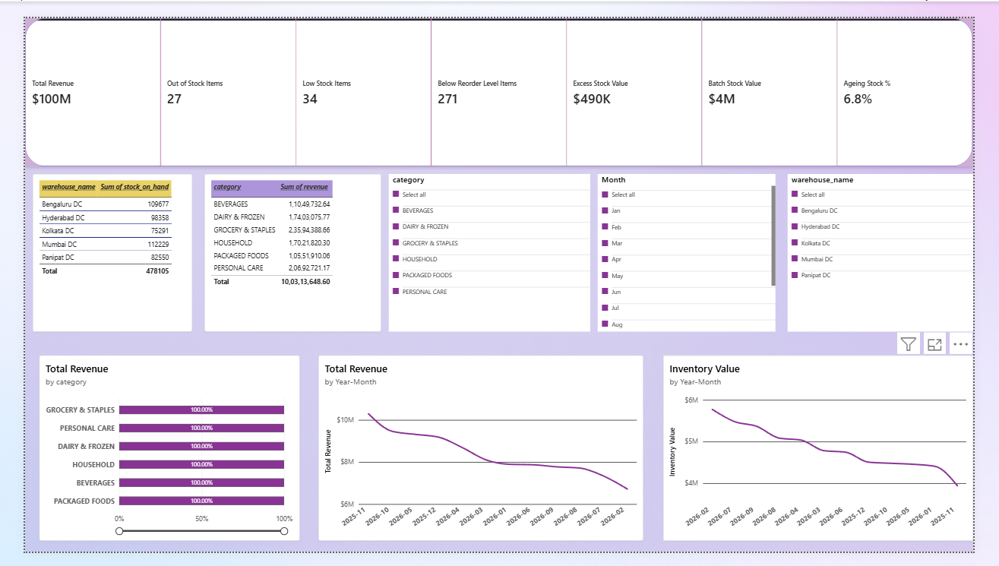
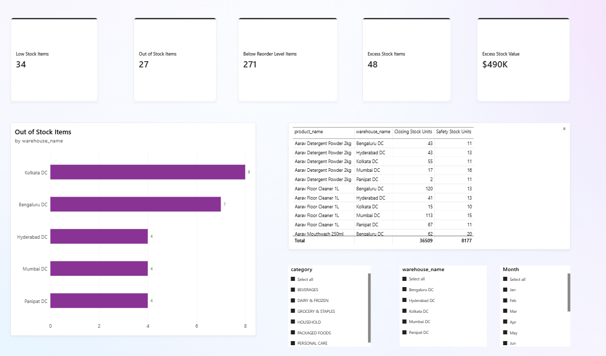
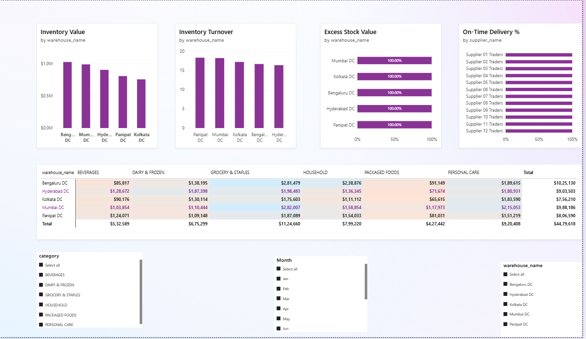
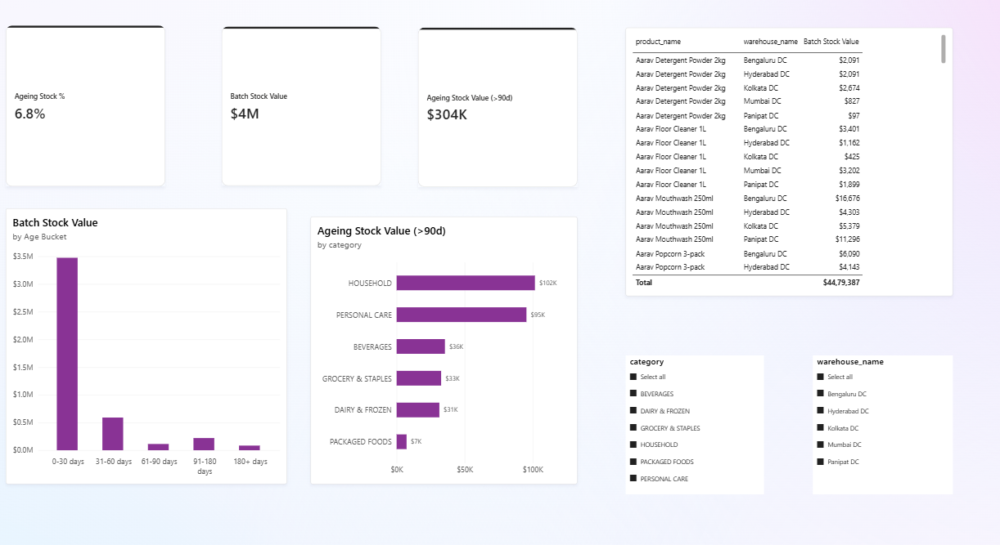
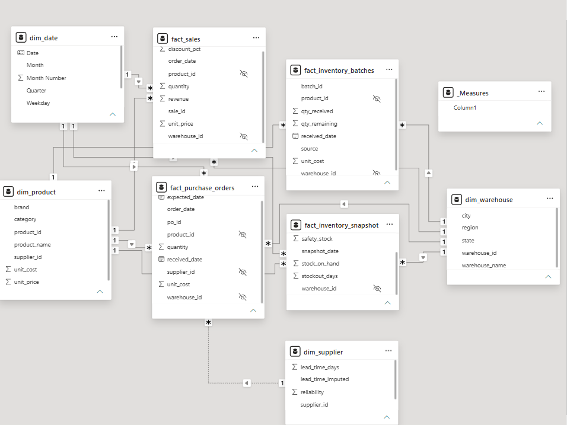

# Supply Chain Inventory Analytics

An end-to-end inventory analytics project: synthetic data generation, data cleaning, a star-schema model, DAX measures, SQL analysis and a four-page Power BI dashboard that highlights low stock, excess stock, ageing inventory and warehouse-level trends, with recommendations for replenishment and inventory review.

> **All data in this project is synthetic.** It is generated by `scripts/generate_dataset.py` and is not real company data. Findings describe this dataset only.

---

## Key findings

| Metric (as of 31 Oct 2026) | Value |
|---|---|
| Revenue (Nov 2025 to Oct 2026) | ₹10.03 crore |
| Inventory value | ₹44.8 lakh |
| Out-of-stock items | 27 |
| Low-stock items (below safety stock) | 34 |
| Excess-stock items | 48 (₹4.90 lakh, 10.9% of inventory value) |
| Ageing stock (over 90 days) | ₹3.04 lakh (6.8% of inventory value) |

*An "item" is one product in one warehouse (600 in total).*

- **Excess stock is concentrated.** Mumbai, Kolkata and Bengaluru hold 74% of it, and Household and Personal Care hold 54%.
- **A few fast sellers are short.** The top 10 low-stock items put about ₹11,200 of sales per day at risk, and four of them have no stock at all.
- **Excess and shortage sit in the same warehouses,** so reorder settings should be reviewed item by item, not warehouse by warehouse.
- **Late suppliers do not explain stockouts here.** On-time delivery varies from 69% to 98% across suppliers, but shows almost no link to stockout days.

Full findings, recommendations and limitations are in [`documentation/insights.md`](documentation/insights.md).

---

## Dashboard

The Power BI report (`powerbi/inventory_analytics.pbix`) has four pages:

| Page | What it shows |
|---|---|
| **Overview** | Revenue, gross margin, inventory value, turnover, out-of-stock and ageing KPIs, with monthly revenue and stock trends |
| **Inventory Health** | Out-of-stock, low-stock, below-reorder-level and excess-stock counts, by warehouse, plus a replenishment priority table |
| **Warehouse & Suppliers** | Inventory value, turnover and excess stock by warehouse, a warehouse-by-category heatmap, and supplier on-time delivery |
| **Ageing** | Stock value by age bucket and category, with a list of batches older than 90 days |

Slicers for month, warehouse and category filter the pages. Ageing is calculated as of 31 Oct 2026 and does not respond to the month slicer.

### Overview


### Inventory health


### Warehouse and suppliers


### Ageing


---

## Business questions

1. Which items are below their safety stock or reorder level, and in which warehouse?
2. Which items are overstocked, and how much capital is tied up in them?
3. How much inventory value is ageing (older than 90 days)?
4. How does stock change month to month, by warehouse and category?
5. Which suppliers deliver late, and how does that relate to stockouts?

---

## Tools

| Tool | Used for |
|---|---|
| Python (pandas, NumPy) | Synthetic data generation |
| Power Query | Data cleaning and transformation |
| Power BI | Data model and dashboard |
| DAX | KPI measures |
| SQL (PostgreSQL) | Cleaning and analytical queries |
| Git / GitHub | Version control |

---

## Workflow

1. **Generate data:** a Python simulator creates 12 months of daily operations.
2. **Clean:** Power Query fixes the raw files, and the same cleaning is repeated in SQL.
3. **Model:** a star schema with a date table.
4. **Measure:** DAX measures for sales, stock health, ageing and supplier KPIs.
5. **Analyse:** SQL queries answer the business questions and cross-check the dashboard.
6. **Report:** the dashboard and the written insights.

---

## Dataset

The generator simulates daily operations for 120 products across 5 warehouses (Panipat, Mumbai, Bengaluru, Kolkata, Hyderabad). Each product-warehouse pair follows a reorder-point policy with FIFO stock batches, so the data is internally consistent: sales never exceed available stock, and current stock equals the sum of remaining batches. Some pairs are deliberately badly managed (reordering too late, over-ordering, or demand collapsing mid-year) so that low stock, excess stock and ageing inventory appear.

| File | Rows | Description |
|---|---|---|
| `dim_product` | 120 | Category, brand, unit cost, unit price, supplier |
| `dim_warehouse` | 5 | City, state, region |
| `dim_supplier` | 12 | Lead time, reliability |
| `dim_reorder_level` | 600 | Reorder level and safety stock per product and warehouse |
| `fact_sales` | 190,305 raw (189,736 after cleaning) | Daily sales with discount and revenue |
| `fact_inventory_snapshot` | 7,200 | Month-end stock on hand and stockout days |
| `fact_purchase_orders` | 8,000+ | Order, expected and received dates, quantity, cost |
| `fact_inventory_batches` | 600+ | Current stock by received date, used for ageing |

---

## Data cleaning

The raw files contain deliberate data-quality issues. They were fixed in Power Query and repeated in SQL (`sql/01_clean_views.sql`).

| Table | Issue | Fix |
|---|---|---|
| `dim_product` | Inconsistent spacing and casing in `category` | Trimmed and standardised to uppercase, leaving 6 clean categories |
| `fact_sales` | 569 duplicate rows | Removed duplicates |
| `dim_supplier` | 2 missing `lead_time_days` values | Filled with the rounded average of the other suppliers, flagged in `lead_time_imputed` |

Mean imputation is simple but hides real differences between suppliers, which is why imputed rows are flagged.

---

## Data model



A star schema with `fact_sales`, `fact_inventory_snapshot`, `fact_purchase_orders` and `fact_inventory_batches` connected to the `dim_product`, `dim_warehouse`, `dim_supplier` and `dim_date` dimensions. All relationships are one-to-many with single-direction filtering.

- Month-end reorder levels and safety stock are merged into the snapshot table, because they share the same product-and-warehouse grain.
- `dim_supplier` connects to purchase orders only, which avoids two competing filter paths.
- Ageing is calculated from batch received dates against a fixed as-of date, so batches have no date relationship.

---

## Key DAX measures

| Area | Measures |
|---|---|
| Sales | Total Revenue, Units Sold, COGS, Gross Margin % |
| Inventory | Closing Stock Units, Inventory Value, Avg Inventory Value, Inventory Turnover |
| Stock health | Out of Stock Items, Low Stock Items, Below Reorder Level Items, Excess Stock Items, Excess Stock Value |
| Ageing | Batch Stock Value, Ageing Stock Value (over 90 days), Ageing Stock % |
| Suppliers | On-Time Delivery % |

Stock measures always use the latest snapshot in the current filter, so month-end figures are not added up across months.

---

## SQL analysis

The `sql/` folder holds the PostgreSQL schema, cleaning views and analysis queries:

| File | Purpose |
|---|---|
| `00_schema.sql` | Table definitions |
| `01_clean_views.sql` | Deduplicated sales, cleaned product and supplier views |
| `02_low_stock.sql` | Items below safety stock |
| `03_excess_stock.sql` | Stock above 90 days of sales |
| `04_ageing.sql` | Inventory value by age bucket |
| `05_monthly_revenue.sql` | Monthly revenue and gross margin |
| `06_turnover_by_warehouse.sql` | Inventory turnover by warehouse |
| `07_supplier_on_time.sql` | Supplier delivery performance |
| `08_top_products.sql` | Top 3 products per category (window function) |
| `09_insight_queries.sql` | Queries behind the written insights |

**Validation:** total revenue matches between SQL and Power BI (₹100,313,649), and total inventory value is identical when calculated from the month-end snapshots and from the batch table (₹4,479,618).

---

## Repository structure

```
supply-chain-inventory-analytics/
├── data/raw/                 # CSV files from the generator
├── scripts/
│   └── generate_dataset.py   # synthetic data generator
├── sql/                      # PostgreSQL schema, cleaning and analysis queries
├── powerbi/
│   └── inventory_analytics.pbix
├── documentation/
│   └── insights.md           # findings and recommendations
├── images/                   # data model and dashboard screenshots
└── README.md
```

---

## How to reproduce

**1. Generate the data**
```bash
pip install pandas numpy
python scripts/generate_dataset.py            # raw files with data-quality issues
python scripts/generate_dataset.py --clean    # no injected issues
```
The generator uses a fixed random seed, so the output is repeatable.

**2. Open the dashboard**
Open `powerbi/inventory_analytics.pbix` in Power BI Desktop. The file reads the CSVs from the path used on the author's machine, so go to **Transform data → Data source settings** and point each source to your local `data/raw/` folder.

**3. Run the SQL**
Create a PostgreSQL database, run `sql/00_schema.sql`, import each CSV from `data/raw/` into the table of the same name, then run `sql/01_clean_views.sql` followed by the analysis queries.

---

## Limitations

- The data is **synthetic** and covers one year, so patterns may not hold for a real business.
- Seasonality and poorly managed items are built into the generator, so some findings reflect that design.
- Excess stock uses a simple rule (more than 90 days of sales), and real thresholds vary by product.
- Ageing uses FIFO batches at a fixed date (31 Oct 2026) and does not model shelf life or expiry.
- Supplier comparisons are not adjusted for the number of items each supplier covers.

---

## Possible improvements

- Add a forecasting layer for demand and reorder points (see the companion demand-forecasting project)
- Add supplier cost and lead-time variability to the reorder policy
- Publish the report to Power BI Service with scheduled refresh

---

## Author

**Nandini Dhiman**, B.Tech Computer Science student and aspiring data analyst.
GitHub: [namihd-inidnan](https://github.com/namihd-inidnan)
